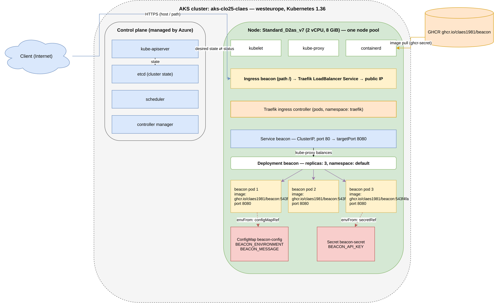

# UrlShortener

A minimal .NET 10 web app for a URL shortener service. It exposes a few read-only endpoints for now; the shortening feature arrives later.

Built as the course project for **Skalbara Molnapplikationer** (scalable cloud applications). The app is intentionally small — the focus of the course is the infrastructure around it: running it on Azure both as an App Service web app and as a container (Azure Container Apps), provisioned with Bicep, deployed through GitHub Actions pipelines, and designed with scaling in mind.

Full documentation: [docs/TUTORIAL.md](docs/TUTORIAL.md) — the endpoints, local development, and the step-by-step for provisioning, deploying, scaling, and verifying both tracks.

## How to run it

1. Create the pull secret, with a GitHub token that has only `read:packages`. The first line waits for you to
   paste the token:

   ```bash
   printf 'GitHub token: ' && read -rs GHCR_TOKEN && echo

   kubectl create secret docker-registry ghcr-secret \
     --docker-server=ghcr.io \
     --docker-username=claes1981 \
     --docker-password=$GHCR_TOKEN
   ```

2. Create the app's secret:

   ```bash
   kubectl create secret generic beacon-secret \
     --from-literal=BEACON_API_KEY='your-key'
   ```

3. Install the chart:

   ```bash
   helm upgrade --install beacon ./charts/beacon
   ```
A green run of the pipeline: [bump beacon to version 5](https://github.com/Claes1981/UrlShortener/actions/runs/42523216122)

## Architecture



The API server is the only way in from the outside to the Cluster, so all traffic from the outside goes here first. The Scheduler picks a node for the Requests with sufficient resources.
The Kubelet is sort of an orchestrator for the Node, as it asks the API server what to run and then start the container in the Node.

The `kubectl apply` command to an already running Pod doesn't change that Pod, you would need to also run `kubectl rollout restart` for the changes to take effect.

### How traffic gets in

The ingress controller that runs in the cluster is **Traefik** (in the `traefik` namespace; the Ingress points to it with `ingressClassName: traefik`). Traefik is exposed through its own LoadBalancer service, which gives the cluster its single public IP. The Ingress `beacon` tells Traefik to send all requests for the path `/` to the ClusterIP service `beacon`, and kube-proxy delivers each request to one of the three pods.

An Ingress is needed on top of a Service because a ClusterIP service is only reachable from inside the cluster. Exposing the service directly would mean a NodePort on every node, or a separate public LoadBalancer IP per service — and neither can route by host or path or terminate TLS. An Ingress gives one public entry point that can route to many services; the object itself is only a set of rules, which the controller (Traefik) watches and applies.

## Repository layout

```
src/UrlShortener.Api/                    The ASP.NET Core minimal API app (incl. Dockerfile)
tests/UrlShortener.Tests/                xUnit endpoint tests
infra/                                   Bicep: main.bicep (App Service), container.bicep (Container Apps)
.github/workflows/deploy.yml             Web track: build, test, zip-deploy
.github/workflows/deploy-container.yml   Container track: build, test, push image, new revision
.github/workflows/hello.yml              First test workflow (week 36 exercise)
scripts/deploy-infra.sh                  Creates the web track from infra/main.bicep
scripts/deploy-container.sh              Creates the container track from infra/container.bicep
scripts/provision-all.sh                 Web track + registry + image + container track in one run
scripts/health-check.sh                  Polls /health until it returns 200
scripts/lab2.sh                          The original Lab 02 az-command script (kept for history)
docs/TUTORIAL.md                         The step-by-step documentation
docs/FORDJUPNING.md                      Deep-dive work log
requests.http                            Manual endpoint requests (send from any editor)
AGENTS.md                                Constraints for AI coding agents working in this repo
```

## Course requirements (status)

The final assignment is the app running twice in Azure (App Service + Container Apps), each with Bicep, CI/CD, and scaling, documented in a step-by-step tutorial.

- [x] .NET 10 app with `/health`, test project, local ports 5001/7001
- [x] Dockerfile for the container build
- [x] Bicep templates for both deployments
- [x] GitHub Actions workflows building and deploying to Azure
- [x] Shell script(s) automating a deployment step
- [x] `docs/TUTORIAL.md` — the step-by-step documentation
